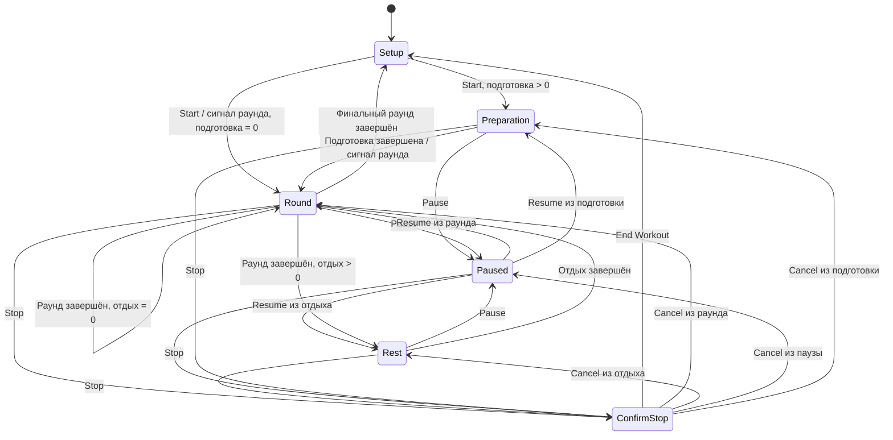

# Train in Intervals: UX Flow

## 1. Цель UX

Пользователь открывает приложение, при необходимости меняет время работы и отдыха и запускает таймер. Звуки таймера настраиваются на отдельном экране.

Статус проверки: поток ниже сверен с текущими SwiftUI-экранами `SetupView`, `SoundSettingsView`, `ActiveTimerView`, `RootView` и Live Activity widget на 22 августа 2026 года.

Основной путь:

```text
Настройки -> Звуки таймера (опционально) -> Начать -> Подготовка (если > 0) -> Работа -> Отдых -> ... -> Последний рабочий интервал -> Настройки
```

### Заставка при открытии приложения

Внутри циферблата одновременно двигаются шесть фигурок. Для HIIT спортсмен делает прыжки с разведением рук и ног, боксёр наносит удары, бегун переставляет ноги и двигает руками, спортсмен с грифом приседает и выжимает его над головой, гребец тянет рукоять, велосипедист крутит педали. Сегменты циферблата постепенно заполняются. Через 1,45 секунды заставка начинает плавно исчезать. При включённом «Уменьшении движения» фигурки и циферблат статичны.

## 2. Карта состояний



## 3. Экран настройки

### Содержимое

- заголовок приложения;
- выбор числа интервалов `1...15`;
- выбор времени подготовки двумя колёсами Minutes и Seconds;
- выбор времени работы двумя колёсами Minutes и Seconds;
- выбор длительности отдыха двумя колёсами Minutes и Seconds;
- выбор предупреждения: Off, 10 sec или 30 sec;
- переход на отдельный экран настройки звуков;
- неблокирующее объяснение про фоновые сигналы, если уведомления ещё не разрешены;
- основная кнопка Start.

Последние значения отображаются сразу. Отдельных кнопок Save, Presets и History нет.

Количество интервалов, подготовка, время работы, отдых и предупреждение настраиваются в отдельных раскрываемых карточках. Альтернатива с одной трёхколоночной карточкой описана в [гипотезе Triple Duration Picker](../hypotheses/triple-duration-picker-2026-08-19.md).

### Экран звуков таймера

- открывается из setup-экрана;
- содержит 3 независимых настройки:
  - начало работы;
  - отдых и завершение;
  - предупреждение;
- каждая настройка выбирает один из встроенных звуков;
- при изменении выбора звук сразу проигрывается для preview;
- при первом открытии экрана preview не запускается автоматически.

### Правила ввода

- секунды выбираются с шагом 5;
- недопустимые значения не показываются либо автоматически приводятся к ближайшему допустимому;
- кнопка Start доступна только для валидной конфигурации;
- VoiceOver получает название настройки и её значение в формате `M:SS`, например «Время работы, 2:30».

### Первый запуск

Показываются 3 интервала по `3:00`, подготовка `0:10`, отдых `1:00` и предупреждение за 10 секунд до конца рабочего интервала. Разрешение на уведомления запрашивается только после явного нажатия «Разрешить уведомления». Отказ не блокирует основной сценарий.

## 4. Активный таймер

### Общая иерархия

1. Текущий этап — «Подготовка», «Работа» или «Отдых».
2. Максимально крупный остаток времени `M:SS`.
3. Индикатор «Интервал 2 из 5».
4. Pause/Resume как основное действие.
5. Stop как визуально вторичное опасное действие.

### Portrait

```text
+-------------------------+
| WORK                    |
|                         |
|          2:17           |
|                         |
|      Interval 2 of 5    |
|                         |
|      [ Pause ]          |
|        Stop             |
+-------------------------+
```

### Landscape

```text
+------------------------------------------------+
| WORK                    2:17       [Pause] Stop |
| Interval 2 of 5                                 |
+------------------------------------------------+
```

Landscape отдаёт основную площадь цифрам. Кнопки остаются доступны и не перекрываются системными safe areas.

### Визуальные состояния

- Подготовка, работа и отдых различаются подписью и цветом. Начало работы и отдыха дополнительно различается по звуковому сигналу.
- На паузе время не меняется, а надпись Paused заменяет название активного этапа или явно дополняет его.
- Цвет не используется как единственный носитель смысла.
- При смене ориентации состояние и остаток времени не сбрасываются.

## 5. Пауза

Pause срабатывает без подтверждения. Экран сохраняет исходный этап и показывает зафиксированный остаток.

Доступные действия:

- Resume — продолжить тот же этап;
- Stop — открыть подтверждение завершения.

В extension объявлены `PauseSessionIntent` и `ResumeSessionIntent`, и изменения сессии через них синхронизируются с открытым приложением. Однако текущий UI Live Activity не содержит интерактивных элементов, которые вызывают эти intents.

## 6. Досрочное завершение

Stop открывает системное подтверждение:

- заголовок: «Завершить тренировку?» / “End workout?”;
- пояснение: текущая сессия не будет сохранена в историю, поскольку истории в MVP нет;
- Cancel;
- End Workout как destructive action.

После End Workout фоновые сигналы отменяются, Live Activity закрывается и отображается экран настройки с последними значениями.

## 7. Штатное завершение

После последней секунды финального раунда:

1. звучит сигнал завершения;
2. активная сессия и Live Activity завершаются, если приложение или extension получают выполнение;
3. приложение возвращается к экрану настройки без отдельного экрана результата.

Если приложение находится в фоне и уведомления разрешены, пользователь получает финальный системный сигнал. При следующем открытии показывается экран настройки.

## 8. Live Activity

### Running

- «Подготовка», «Работа» или «Отдых»;
- счётчик с подписью «Интервал» и значением в формате `2/5`;
- системный обратный отсчёт до границы этапа;
- без интерактивных действий.

### Paused

- Paused;
- исходный этап и номер интервала;
- зафиксированный остаток;
- без интерактивных действий.

### Stale

После границы этапа Live Activity не пытается самостоятельно показывать следующий этап без запуска кода приложения:

- показывает маркировку устаревших данных вместо актуального отсчёта;
- не содержит Pause/Resume или действия для открытия приложения;
- не влияет на заранее запланированные фоновые сигналы.

После открытия приложения актуальное состояние рассчитывается по временным меткам и снова передаётся в Live Activity.

### Недоступность

Если Live Activities отключены, основной таймер продолжает работать. Отдельное сообщение о недоступности Live Activity в текущем UI не реализовано.

Live Activity без серверных push-обновлений гарантированно показывает актуальный этап только до ближайшей границы. Это системное ограничение отражается stale-состоянием вместо показа неверного раунда на `0:00`.

## 9. Фоновые переходы

### Блокировка или другое приложение

- сессия продолжает идти;
- экранный UI не является источником времени;
- границы этапов сопровождаются заранее запланированными системными сигналами;
- возврат открывает актуальный этап.

### Телефонный звонок

Таймер продолжает идти. Звук границы может быть прерван системой. После звонка приложение не воспроизводит задним числом все пропущенные сигналы, а показывает актуальное состояние.

### Принудительное закрытие

Приложение не обещает выполнение собственного кода после force quit. При следующем запуске оно восстанавливает расчётное состояние по сохранённым данным. Если сессия уже закончилась, открываются настройки.

## 10. Разрешения и сообщения

### Уведомления не разрешены

Перед запуском или после отказа на setup-экране показывается неблокирующее объяснение:

> Разрешите уведомления, чтобы слышать сигналы при заблокированном экране. Беззвучный режим, Focus и звонки могут их заглушить.

Если статус разрешения ещё не определён, рядом показывается кнопка `Разрешить уведомления`. Пользователь может продолжить без перехода в Settings. После отказа карточка объясняет, что фоновые сигналы отключены и что нужно разрешить уведомления в настройках Train in Intervals; нажатие на карточку открывает системные настройки приложения.

### Ограничения звука

Текст не должен обещать, что сигнал прозвучит «всегда». Допустимая формулировка:

> Системные режимы без звука, Focus и активный звонок могут заглушить фоновые сигналы.

## 11. Локализация

Приложение и Live Activity используют общие файлы `Main/Resources/Localization/<locale>.lproj/Localizable.strings`. Таймер отображает время в формате `M:SS`.

| Русский | English | Español (México) | Português (Brasil) | Deutsch |
|---|---|---|---|---|
| Работа | Work | Ejercicio | Exercício | Belastung |
| Интервал | Interval | Intervalo | Intervalo | Intervall |
| Отдых | Rest | Descanso | Descanso | Erholung |
| Пауза | Pause | Pausar | Pausar | Anhalten |
| Продолжить | Resume | Reanudar | Retomar | Fortsetzen |
| Завершить | Stop | Terminar | Encerrar | Beenden |
| Начать | Start | Iniciar | Iniciar | Starten |

## 12. UX-критерии приёмки

- Сценарий с тремя интервалами по `2:30` и отдыхом `1:15` настраивается без текстовой клавиатуры.
- Start доступен на стартовом экране без дополнительной навигации.
- В portrait и landscape время читается с расстояния, типичного для индивидуальной тренировки.
- Пользователь всегда может определить этап без опоры только на цвет.
- Одно случайное нажатие Stop не завершает сессию.
- Пауза и продолжение сохраняют номер интервала и остаток времени.
- После штатного и досрочного завершения настройки сохраняются.
